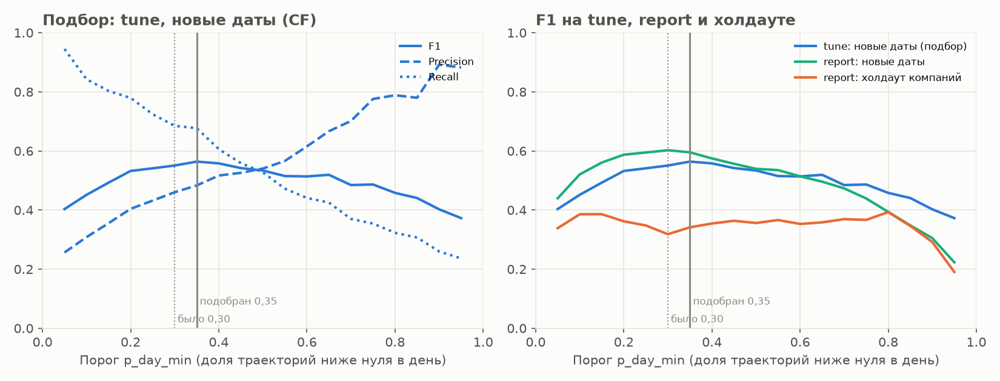
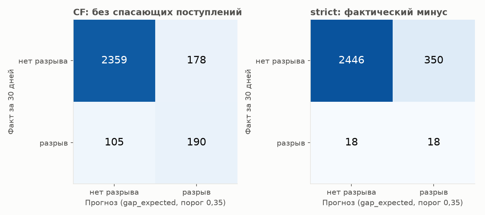
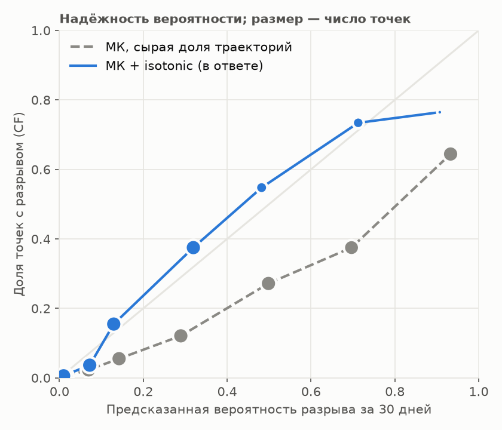
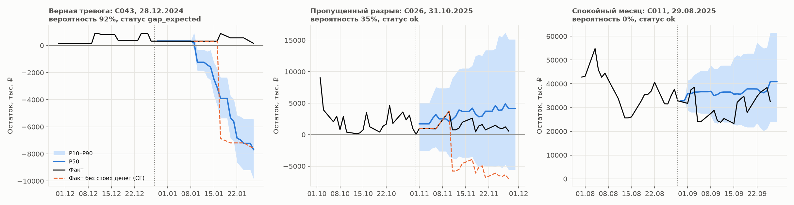

# Контрольный датасет: отчёт v2

## Главное: разрыв в ближайшие 30 дней — v2 (продукт: порог 0,35, isotonic)

| Метка, данные | Точек | Accuracy | Precision | Recall | F1 | ROC-AUC | Brier |
|---|---|---|---|---|---|---|---|
| CF (без своих денег), все данные | 2 832 | 0,900 | 0,516 | 0,644 | 0,573 | 0,916 | 0,063 |
| CF (без своих денег), холдаут компаний | 280 | 0,904 | 0,357 | 0,526 | 0,426 | 0,893 | 0,051 |
| strict (фактический минус), все данные | 2 832 | 0,870 | 0,049 | 0,500 | 0,089 | 0,842 | 0,043 |
| strict (фактический минус), холдаут компаний | 280 | 0,904 | 0,107 | 0,600 | 0,182 | 0,867 | 0,034 |

Матрица ошибок, абсолютные числа (прогноз — статус `gap_expected`):

| Метка, данные | TP | FP | FN | TN |
|---|---|---|---|---|
| CF (без своих денег), все данные | 190 | 178 | 105 | 2 359 |
| CF (без своих денег), холдаут компаний | 10 | 18 | 9 | 243 |
| strict (фактический минус), все данные | 18 | 350 | 18 | 2 446 |
| strict (фактический минус), холдаут компаний | 3 | 25 | 2 | 250 |

TP — разрыв предсказан и был; FP — ложная тревога; FN — пропущенный разрыв; TN — верно «спокойно». CF — основная метка продукта: минус, который был бы без денег владельца (переводов из другого банка и займов учредителя); strict — фактический минус на счёте. Вероятность (ROC-AUC, Brier) — откалиброванная под CF, поэтому Brier для strict выше, чем у константы «доля разрывов» (см. подробные таблицы).

## Данные и время

- Данные: `cashflow_data/cashflow_dataset_participants` — компаний 150, операций 222 399, 01.10.2024 … 30.09.2026.
- Модель: `lgbm_net-v2`, обучена до 2026-09-30. Это датасет участников: модель видела все его даты, метрики in-sample, кроме холдаута компаний (15 шт.). Честные out-of-time цифры — backtest, блок ниже и reports/experiments.csv.
- Точки прогноза: последний рабочий день месяца с 30 днями факта после — 2979; прогноз построен для 2973, счёт закрыт — 6, другие отказы — 0; с пропуском данных на горизонте (не оцениваются) — 56; остаток уже < 0 на дату прогноза (отдельно) — 85.
- **Время на полном датасете: 6,5 мин** (цель ≤ 15): загрузка 6 с, прогнозы 372 с (6 процессов, 0,73 с на прогноз), метрики и графики 12 с.

## Порог тревоги: 0,30 → 0,35

Подбор в backtest (`python -m ml.evaluation.threshold`): порог доли траекторий ниже нуля в день, максимум F1 по CF строго на tune-фолдах (новые даты), затем без изменений — report и холдаут:

| Набор | Порог | Precision | Recall | F1 | TP | FP | FN | TN |
|---|---|---|---|---|---|---|---|---|
| report: новые даты | 0,30 | 0,536 | 0,687 | 0,602 | 325 | 281 | 148 | 2 672 |
| report: новые даты | 0,35 | 0,556 | 0,641 | 0,595 | 303 | 242 | 170 | 2 711 |
| report: холдаут компаний | 0,30 | 0,275 | 0,378 | 0,318 | 14 | 37 | 23 | 330 |
| report: холдаут компаний | 0,35 | 0,311 | 0,378 | 0,341 | 14 | 31 | 23 | 336 |
| tune: новые даты (подбор) | 0,30 | 0,460 | 0,685 | 0,551 | 87 | 102 | 40 | 669 |
| tune: новые даты (подбор) | 0,35 | 0,483 | 0,677 | 0,564 | 86 | 92 | 41 | 679 |
| холдаут, все периоды | 0,30 | 0,258 | 0,425 | 0,321 | 17 | 49 | 23 | 411 |
| холдаут, все периоды | 0,35 | 0,283 | 0,425 | 0,340 | 17 | 43 | 23 | 417 |



На этом датасете (CF):

| Данные | Вариант | Precision | Recall | F1 | TP | FP | FN | TN |
|---|---|---|---|---|---|---|---|---|
| все данные | v2 (продукт: порог 0,35, isotonic) | 0,516 | 0,644 | 0,573 | 190 | 178 | 105 | 2 359 |
| все данные | v2, порог 0,30 | 0,479 | 0,698 | 0,568 | 206 | 224 | 89 | 2 313 |
| холдаут | v2 (продукт: порог 0,35, isotonic) | 0,357 | 0,526 | 0,426 | 10 | 18 | 9 | 243 |
| холдаут | v2, порог 0,30 | 0,303 | 0,526 | 0,385 | 10 | 23 | 9 | 238 |
| компании из обучения | v2 (продукт: порог 0,35, isotonic) | 0,529 | 0,652 | 0,584 | 180 | 160 | 96 | 2 116 |
| компании из обучения | v2, порог 0,30 | 0,494 | 0,710 | 0,582 | 196 | 201 | 80 | 2 075 |

Порог меняет только статус и дату разрыва; вероятность, коридор и суммы те же.

## Ошибка остатка P50 по горизонтам

Ошибка считается по каждой компании (по всем её точкам), затем среднее и медиана по компаниям. Среднее в рублях определяют несколько крупных компаний, медиана — типичная компания; в оборотах — ошибка, делённая на средний дневной оборот компании (сравнимо между компаниями).

### Против фактического остатка из выписки

| Дней | Прогноз | MAE ср., ₽ | MAE мед., ₽ | MSE ср., ₽² | MSE мед., ₽² | RMSE ср., ₽ | RMSE мед., ₽ | MAE, оборотов (ср.) | MAE, оборотов (мед.) | RMSE, оборотов (ср.) | P10–P90 |
|---|---|---|---|---|---|---|---|---|---|---|---|
| 1 | v2 P50 | 130 803 | 64 242 | 282 520 102 997 | 15 256 741 691 | 279 595 | 123 512 | 0,33 | 0,22 | 0,71 | 0,95 |
| 1 | остаток не меняется | 85 122 | 38 480 | 201 122 427 778 | 7 064 316 740 | 207 142 | 84 047 | 0,22 | 0,13 | 0,54 | — |
| 1 | dow_mean | 109 022 | 41 682 | 253 326 162 478 | 7 413 075 928 | 243 897 | 86 099 | 0,25 | 0,15 | 0,59 | — |
| 7 | v2 P50 | 713 624 | 291 333 | 3 702 382 082 490 | 155 892 346 916 | 1 018 424 | 394 832 | 1,85 | 1,05 | 3,29 | 0,89 |
| 7 | остаток не меняется | 890 442 | 374 576 | 6 185 215 570 137 | 231 416 631 622 | 1 259 237 | 481 058 | 2,06 | 1,25 | 3,43 | — |
| 7 | dow_mean | 1 005 380 | 397 608 | 7 489 585 625 151 | 271 420 099 914 | 1 403 336 | 520 978 | 2,32 | 1,37 | 3,71 | — |
| 14 | v2 P50 | 1 102 505 | 438 125 | 6 756 545 871 860 | 347 448 785 761 | 1 465 110 | 589 360 | 5,55 | 1,76 | 12,30 | 0,83 |
| 14 | остаток не меняется | 1 339 891 | 548 968 | 12 567 459 401 824 | 493 927 646 502 | 1 786 246 | 702 740 | 5,66 | 1,81 | 12,36 | — |
| 14 | dow_mean | 1 629 647 | 667 661 | 17 564 172 552 628 | 705 121 228 588 | 2 103 155 | 839 704 | 6,31 | 2,23 | 13,02 | — |
| 30 | v2 P50 | 1 472 031 | 685 480 | 11 222 234 431 839 | 843 856 427 163 | 1 975 454 | 918 616 | 6,57 | 2,47 | 13,74 | 0,84 |
| 30 | остаток не меняется | 1 478 891 | 606 616 | 14 794 743 878 523 | 575 721 709 462 | 2 030 634 | 758 701 | 5,99 | 2,29 | 12,86 | — |
| 30 | dow_mean | 2 411 490 | 967 167 | 32 624 916 085 600 | 1 421 057 484 825 | 3 047 744 | 1 192 021 | 7,85 | 3,52 | 14,85 | — |

### Против операционного остатка (без своих переводов, денег учредителя и разовых операций — как nMAE в backtest)

| Дней | Прогноз | MAE ср., ₽ | MAE мед., ₽ | MSE ср., ₽² | MSE мед., ₽² | RMSE ср., ₽ | RMSE мед., ₽ | MAE, оборотов (ср.) | MAE, оборотов (мед.) | RMSE, оборотов (ср.) | P10–P90 |
|---|---|---|---|---|---|---|---|---|---|---|---|
| 1 | v2 P50 | 127 688 | 64 242 | 201 149 457 869 | 16 040 082 036 | 261 822 | 126 635 | 0,32 | 0,22 | 0,67 | 0,95 |
| 1 | остаток не меняется | 82 953 | 40 394 | 127 458 146 727 | 7 820 947 283 | 193 961 | 88 415 | 0,22 | 0,13 | 0,53 | — |
| 1 | dow_mean | 105 336 | 43 632 | 171 572 026 199 | 8 192 067 491 | 225 681 | 90 502 | 0,25 | 0,16 | 0,55 | — |
| 7 | v2 P50 | 687 218 | 294 258 | 3 656 994 295 137 | 157 741 734 182 | 945 168 | 397 161 | 1,58 | 1,01 | 2,66 | 0,90 |
| 7 | остаток не меняется | 900 631 | 385 861 | 7 367 489 374 579 | 258 433 529 388 | 1 265 356 | 508 305 | 1,96 | 1,39 | 3,14 | — |
| 7 | dow_mean | 982 441 | 389 549 | 8 440 083 216 265 | 283 491 972 355 | 1 377 650 | 532 434 | 2,13 | 1,41 | 3,31 | — |
| 14 | v2 P50 | 1 016 674 | 428 810 | 5 945 551 378 413 | 344 975 758 103 | 1 334 951 | 587 291 | 5,14 | 1,67 | 11,54 | 0,85 |
| 14 | остаток не меняется | 1 414 010 | 566 097 | 14 512 734 000 372 | 568 405 926 657 | 1 857 894 | 753 924 | 5,74 | 2,13 | 12,29 | — |
| 14 | dow_mean | 1 572 565 | 661 322 | 18 554 550 662 716 | 716 756 894 633 | 2 076 985 | 846 542 | 6,05 | 2,37 | 12,60 | — |
| 30 | v2 P50 | 1 261 112 | 569 783 | 8 500 216 121 684 | 547 244 903 274 | 1 671 534 | 739 751 | 5,69 | 1,99 | 12,34 | 0,90 |
| 30 | остаток не меняется | 1 867 575 | 778 758 | 21 167 976 561 367 | 956 039 571 980 | 2 422 857 | 976 975 | 6,74 | 2,90 | 13,57 | — |
| 30 | dow_mean | 2 391 989 | 957 696 | 35 256 638 376 839 | 1 374 822 217 832 | 3 073 964 | 1 172 508 | 7,56 | 3,58 | 14,40 | — |

**Почему на фактическом остатке «остаток не меняется» на 30 дней точнее и почему он от этого не полезнее.** На 30 днях против фактического остатка наивный прогноз выигрывает у P50 по медиане компаний и в оборотах (по среднему в рублях — примерно вровень). Фактический остаток включает переводы своих средств из другого банка и деньги учредителя: когда денег мало, владелец сам доливает счёт, когда много — выводит. Остаток через месяц поэтому часто возвращается к привычному уровню, и константа «как сегодня» попадает близко. Модель сознательно не прогнозирует эти переводы — это реакция владельца на нехватку, а не денежный поток бизнеса, и именно эту нехватку мы должны показать заранее. На операционном остатке (без этих переводов) P50 точнее наивного на 7–30 днях. А для задачи продукта наивный прогноз бесполезен: остаток у него не меняется, поэтому он никогда не предсказывает разрыв — recall 0 по обеим меткам (строка «остаток не меняется» в подробных таблицах), все разрывы пропущены. На 1 день наивный тоже точнее, так же и в backtest (nMAE d1 0,95 против 0,97): точки здесь — конец месяца, и модель на следующий день ждёт поступлений, которые часто приходят позже.

## Как посчитано: один прогноз по шагам (C027 на 31.08.2026)

То же поле `trace` в ответе сервиса (вкладка «Как посчитано»). Время каждого шага — в мс; рублёвые суммы есть в JSON, в лог не пишутся.

```
C027 на 31.08.2026: статус gap_expected
Шаг 1. Очистка — 14 мс: history_days=473; gaps_in_data=2; oneoff_days=3; operations=370; duplicate=0; own_transfer=0; founder_financing=0; error_refund=0
Шаг 2. Категории платежей — время — в шаге 3: categorized=370; categories=15; unknown_share=0.003; top: [suppliers 126, services_other 39, revenue_client 36, tax_enp 26, bank_fee 20, salary_advance 20, utilities 20, salary_settlement 20]
Шаг 3. Регулярные платежи — 204 мс: streams=14; mandatory_streams=6; inflow_streams=2; regular_operations=226; regular_share=0.611; overdue_streams=0
Шаг 4. Будущие события — 0 мс: events=6; mandatory=6; from_user=0; overdue=0; left_to_model=8
Шаг 5. Модель прогноза — 95 мс: model_version=lgbm_net-v2; model=lgbm_net; working_days=22
Шаг 6. Монте-Карло — 0 мс: paths=1000; seed=42; error_pool=industry; error_pool_size=408; widen=1.0
Шаг 7. Кассовый разрыв — 8 мс: p_day_min=0.35; max_p_day=0.552; probability_raw=0.75; probability=0.351; calibrated=True; status=gap_expected; gap_date=2026-09-15
Шаг 8. Сценарий «что если» — 0 мс: applied=False
Шаг 9. План-факт — —: available=False; endpoint=/plan-fact
Итого 322 мс
```

## Подробно: разрывы, все предсказатели и бейзлайны

### Метка CF — все точки

| Предсказатель | Разрывов | Accuracy | Precision | Recall | F1 | ROC-AUC | Brier | ECE |
|---|---|---|---|---|---|---|---|---|
| v2 (продукт: порог 0,35, isotonic) | 295 | 0,900 | 0,516 | 0,644 | 0,573 | 0,916 | 0,063 | 0,020 |
| v2, порог 0,30 | 295 | 0,889 | 0,479 | 0,698 | 0,568 | 0,916 | 0,063 | 0,020 |
| v2: сырая доля траекторий МК | 295 | — | — | — | — | 0,920 | 0,079 | 0,086 |
| остаток не меняется | 295 | 0,896 | — | 0,000 | — | — | — | — |
| тренд 60 р.д. | 295 | 0,876 | 0,398 | 0,369 | 0,383 | 0,846 | — | — |
| низкий остаток (только AUC) | 295 | — | — | — | — | 0,855 | — | — |
| климатология (знает долю разрывов) | 295 | — | — | — | — | — | 0,093 | 0,000 |

### Метка CF — холдаут компаний (модель их не видела)

| Предсказатель | Разрывов | Accuracy | Precision | Recall | F1 | ROC-AUC | Brier | ECE |
|---|---|---|---|---|---|---|---|---|
| v2 (продукт: порог 0,35, isotonic) | 19 | 0,904 | 0,357 | 0,526 | 0,426 | 0,893 | 0,051 | 0,028 |
| v2, порог 0,30 | 19 | 0,886 | 0,303 | 0,526 | 0,385 | 0,893 | 0,051 | 0,028 |
| v2: сырая доля траекторий МК | 19 | — | — | — | — | 0,900 | 0,079 | 0,102 |
| остаток не меняется | 19 | 0,932 | — | 0,000 | — | — | — | — |
| тренд 60 р.д. | 19 | 0,854 | 0,133 | 0,211 | 0,163 | 0,735 | — | — |
| низкий остаток (только AUC) | 19 | — | — | — | — | 0,750 | — | — |
| климатология (знает долю разрывов) | 19 | — | — | — | — | — | 0,063 | 0,000 |

### Метка CF — компании из обучения

| Предсказатель | Разрывов | Accuracy | Precision | Recall | F1 | ROC-AUC | Brier | ECE |
|---|---|---|---|---|---|---|---|---|
| v2 (продукт: порог 0,35, isotonic) | 276 | 0,900 | 0,529 | 0,652 | 0,584 | 0,918 | 0,064 | 0,021 |
| v2, порог 0,30 | 276 | 0,890 | 0,494 | 0,710 | 0,582 | 0,918 | 0,064 | 0,021 |
| v2: сырая доля траекторий МК | 276 | — | — | — | — | 0,922 | 0,079 | 0,085 |
| остаток не меняется | 276 | 0,892 | — | 0,000 | — | — | — | — |
| тренд 60 р.д. | 276 | 0,879 | 0,430 | 0,380 | 0,404 | 0,855 | — | — |
| низкий остаток (только AUC) | 276 | — | — | — | — | 0,862 | — | — |
| климатология (знает долю разрывов) | 276 | — | — | — | — | — | 0,096 | 0,000 |

### Метка strict — все точки

| Предсказатель | Разрывов | Accuracy | Precision | Recall | F1 | ROC-AUC | Brier | ECE |
|---|---|---|---|---|---|---|---|---|
| v2 (продукт: порог 0,35, isotonic) | 36 | 0,870 | 0,049 | 0,500 | 0,089 | 0,842 | 0,043 | 0,089 |
| v2, порог 0,30 | 36 | 0,850 | 0,049 | 0,583 | 0,090 | 0,842 | 0,043 | 0,089 |
| v2: сырая доля траекторий МК | 36 | — | — | — | — | 0,847 | 0,112 | 0,178 |
| остаток не меняется | 36 | 0,987 | — | 0,000 | — | — | — | — |
| тренд 60 р.д. | 36 | 0,897 | 0,033 | 0,250 | 0,058 | 0,774 | — | — |
| низкий остаток (только AUC) | 36 | — | — | — | — | 0,743 | — | — |
| климатология (знает долю разрывов) | 36 | — | — | — | — | — | 0,013 | 0,000 |

### Метка strict — холдаут компаний (модель их не видела)

| Предсказатель | Разрывов | Accuracy | Precision | Recall | F1 | ROC-AUC | Brier | ECE |
|---|---|---|---|---|---|---|---|---|
| v2 (продукт: порог 0,35, isotonic) | 5 | 0,904 | 0,107 | 0,600 | 0,182 | 0,867 | 0,034 | 0,070 |
| v2, порог 0,30 | 5 | 0,886 | 0,091 | 0,600 | 0,158 | 0,867 | 0,034 | 0,070 |
| v2: сырая доля траекторий МК | 5 | — | — | — | — | 0,869 | 0,092 | 0,152 |
| остаток не меняется | 5 | 0,982 | — | 0,000 | — | — | — | — |
| тренд 60 р.д. | 5 | 0,875 | 0,000 | 0,000 | — | 0,409 | — | — |
| низкий остаток (только AUC) | 5 | — | — | — | — | 0,447 | — | — |
| климатология (знает долю разрывов) | 5 | — | — | — | — | — | 0,018 | 0,000 |

### Метка strict — компании из обучения

| Предсказатель | Разрывов | Accuracy | Precision | Recall | F1 | ROC-AUC | Brier | ECE |
|---|---|---|---|---|---|---|---|---|
| v2 (продукт: порог 0,35, isotonic) | 31 | 0,866 | 0,044 | 0,484 | 0,081 | 0,838 | 0,044 | 0,091 |
| v2, порог 0,30 | 31 | 0,846 | 0,045 | 0,581 | 0,084 | 0,838 | 0,044 | 0,091 |
| v2: сырая доля траекторий МК | 31 | — | — | — | — | 0,844 | 0,115 | 0,181 |
| остаток не меняется | 31 | 0,988 | — | 0,000 | — | — | — | — |
| тренд 60 р.д. | 31 | 0,899 | 0,037 | 0,290 | 0,065 | 0,836 | — | — |
| низкий остаток (только AUC) | 31 | — | — | — | — | 0,790 | — | — |
| климатология (знает долю разрывов) | 31 | — | — | — | — | — | 0,012 | 0,000 |

Precision/recall/F1/accuracy — по статусу `gap_expected`. «Сырая доля траекторий» — вероятность до isotonic, у неё только ROC-AUC, Brier и ECE. «Климатология» знает долю разрывов в этом же наборе — нижняя граница Brier, а не честный соперник. Вероятность в ответе калибрована под CF-метку (её разрывов в ~8 раз больше, чем фактических минусов), поэтому для strict Brier и ECE хуже климатологии: для strict смотреть на recall и ROC-AUC.



## Надёжность вероятности



## Примеры компаний



- **Верная тревога** — C043 на 28.12.2024: статус `gap_expected`, вероятность 92%, CF-разрыв в факте: да.
- **Пропущенный разрыв** — C026 на 31.10.2025: статус `ok`, вероятность 35%, CF-разрыв в факте: да.
- **Спокойный месяц** — C011 на 29.08.2025: статус `ok`, вероятность 0%, CF-разрыв в факте: нет.

## Эксперименты (backtest, не контрольный датасет)
### Вероятность разрыва: МК против модели выживаемости (8.6), period=report
| Набор | AUC МК | AUC hazard | Brier МК+isotonic | Brier hazard | ECE МК сырой | ECE МК+isotonic | ECE hazard |
|---|---|---|---|---|---|---|---|
| новые даты | 0,903 | 0,908 | 0,079 | 0,080 | 0,075 | 0,030 | 0,049 |
| холдаут | 0,841 | 0,851 | 0,077 | 0,083 | 0,088 | 0,041 | 0,068 |

hazard различает чуть лучше (AUC), но занижает вероятность; калиброванный МК надёжнее по Brier и ECE — в продукте остаётся МК + isotonic. Isotonic по CF-метке на tune-фолдах снижает ECE сырой доли траекторий примерно в 2–2,5 раза.

### Оракулы (8.0): потолок, если одна часть прогноза идеальна; report, новые даты
| Вариант | nMAE d7 | nMAE d30 | CF P | CF R | Покрытие P10–P90 |
|---|---|---|---|---|---|
| v2 (как есть) | 1,64 | 3,23 | 0,54 | 0,69 | 0,79 |
| O1: нерегулярная часть = факт | 0,57 | 1,34 | 0,64 | 0,84 | 0,67 |
| O2: события = факт | 1,43 | 2,93 | 0,52 | 0,74 | 0,80 |
| O3: даты поступлений = факт | 1,59 | 3,23 | 0,48 | 0,77 | 0,79 |

Потолок — нерегулярная часть (O1): точные события (O2) и даты поступлений (O3) почти ничего не дают.

### Отвергнутые эксперименты (решение по tune, CF recall при CF precision ≥ 0,45)
| Эксперимент | Почему не включён |
|---|---|
| 8.1 признаки остатка (+ last_year) | CF recall на tune упал: 0,685 → 0,646 |
| Перенос просроченных поступлений клиентов в прогноз | recall на tune вырос (0,685 → 0,748), но остаток d7 хуже на 7% (1,83 → 1,95), на report recall +1 п.п. при d7 +8% — флаг выключен |
| 8.5 v2_cf (переносы обязательных платежей на нормальные даты) | CF recall на tune не изменился (0,685), меняются только даты событий у 21% точек |
| 8.2 last_year без признаков остатка | не включён: CF recall на tune 0,685 → 0,669, precision 0,457 |
