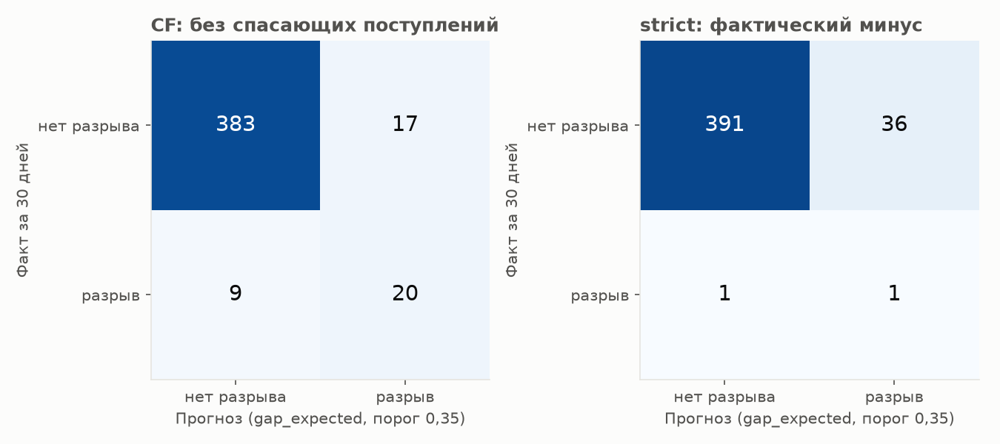
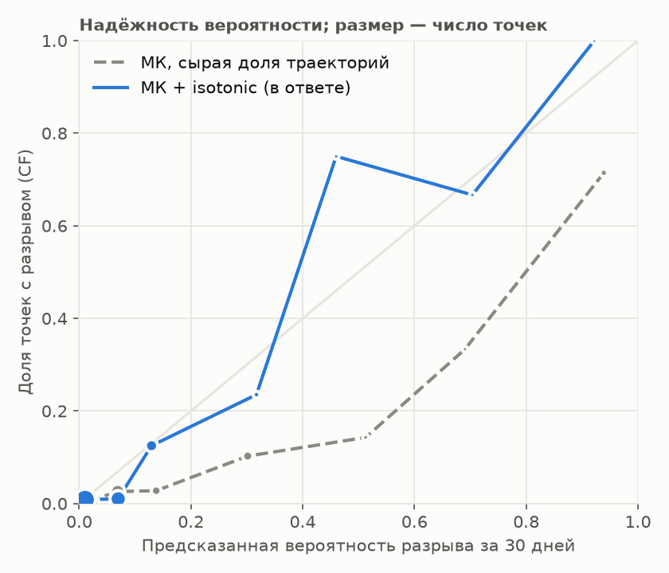
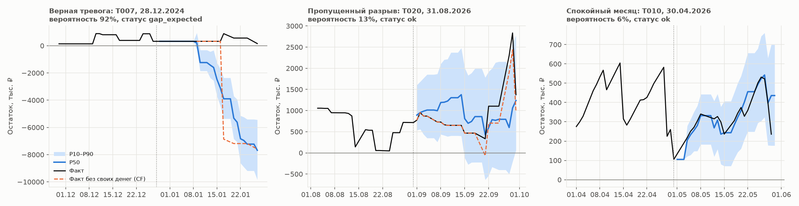

# Контрольный датасет: отчёт v2

## Главное: разрыв в ближайшие 30 дней — v2 (продукт: порог 0,35, isotonic)

| Метка, данные | Точек | Accuracy | Precision | Recall | F1 | ROC-AUC | Brier |
|---|---|---|---|---|---|---|---|
| CF (без своих денег), все данные | 429 | 0,939 | 0,541 | 0,690 | 0,606 | 0,921 | 0,039 |
| strict (фактический минус), все данные | 429 | 0,914 | 0,027 | 0,500 | 0,051 | 0,912 | 0,030 |

Матрица ошибок, абсолютные числа (прогноз — статус `gap_expected`):

| Метка, данные | TP | FP | FN | TN |
|---|---|---|---|---|
| CF (без своих денег), все данные | 20 | 17 | 9 | 383 |
| strict (фактический минус), все данные | 1 | 36 | 1 | 391 |

TP — разрыв предсказан и был; FP — ложная тревога; FN — пропущенный разрыв; TN — верно «спокойно». CF — основная метка продукта: минус, который был бы без денег владельца (переводов из другого банка и займов учредителя); strict — фактический минус на счёте. Вероятность (ROC-AUC, Brier) — откалиброванная под CF, поэтому Brier для strict выше, чем у константы «доля разрывов» (см. подробные таблицы).

## Данные и время

- Данные: `/tmp/claude-1000/-home-sergey/a1bd8008-cc8c-4c69-877b-f652932afd8a/scratchpad/foreign_data` — компаний 20, операций 31 718, 01.10.2024 … 30.09.2026.
- Модель: `lgbm_net-v2`, обучена до 2026-09-30. Если в этих данных те же компании и даты, что в обучении (до 2026-09-30), метрики in-sample; на новых компаниях или датах после обучения — честная проверка.
- Точки прогноза: последний рабочий день месяца с 30 днями факта после — 446; прогноз построен для 445, счёт закрыт — 1, другие отказы — 0; с пропуском данных на горизонте (не оцениваются) — 11; остаток уже < 0 на дату прогноза (отдельно) — 5.
- **Время на полном датасете: 0,8 мин** (цель ≤ 15): загрузка 1 с, прогнозы 44 с (6 процессов, 0,55 с на прогноз), метрики и графики 3 с.

## Порог тревоги: 0,30 → 0,35

Подбор в backtest (`python -m ml.evaluation.threshold`): порог доли траекторий ниже нуля в день, максимум F1 по CF строго на tune-фолдах (новые даты), затем без изменений — report и холдаут:

| Набор | Порог | Precision | Recall | F1 | TP | FP | FN | TN |
|---|---|---|---|---|---|---|---|---|
| report: новые даты | 0,30 | 0,536 | 0,687 | 0,602 | 325 | 281 | 148 | 2 672 |
| report: новые даты | 0,35 | 0,556 | 0,641 | 0,595 | 303 | 242 | 170 | 2 711 |
| report: холдаут компаний | 0,30 | 0,275 | 0,378 | 0,318 | 14 | 37 | 23 | 330 |
| report: холдаут компаний | 0,35 | 0,311 | 0,378 | 0,341 | 14 | 31 | 23 | 336 |
| tune: новые даты (подбор) | 0,30 | 0,460 | 0,685 | 0,551 | 87 | 102 | 40 | 669 |
| tune: новые даты (подбор) | 0,35 | 0,483 | 0,677 | 0,564 | 86 | 92 | 41 | 679 |
| холдаут, все периоды | 0,30 | 0,258 | 0,425 | 0,321 | 17 | 49 | 23 | 411 |
| холдаут, все периоды | 0,35 | 0,283 | 0,425 | 0,340 | 17 | 43 | 23 | 417 |


На этом датасете (CF):

| Данные | Вариант | Precision | Recall | F1 | TP | FP | FN | TN |
|---|---|---|---|---|---|---|---|---|
| все данные | v2 (продукт: порог 0,35, isotonic) | 0,541 | 0,690 | 0,606 | 20 | 17 | 9 | 383 |
| все данные | v2, порог 0,30 | 0,476 | 0,690 | 0,563 | 20 | 22 | 9 | 378 |

Порог меняет только статус и дату разрыва; вероятность, коридор и суммы те же.

## Ошибка остатка P50 по горизонтам

Ошибка считается по каждой компании (по всем её точкам), затем среднее и медиана по компаниям. Среднее в рублях определяют несколько крупных компаний, медиана — типичная компания; в оборотах — ошибка, делённая на средний дневной оборот компании (сравнимо между компаниями).

### Против фактического остатка из выписки

| Дней | Прогноз | MAE ср., ₽ | MAE мед., ₽ | MSE ср., ₽² | MSE мед., ₽² | RMSE ср., ₽ | RMSE мед., ₽ | MAE, оборотов (ср.) | MAE, оборотов (мед.) | RMSE, оборотов (ср.) | P10–P90 |
|---|---|---|---|---|---|---|---|---|---|---|---|
| 1 | v2 P50 | 181 700 | 67 594 | 834 903 991 183 | 17 184 167 840 | 438 807 | 131 065 | 0,38 | 0,20 | 1,01 | 0,97 |
| 1 | остаток не меняется | 120 558 | 49 709 | 693 590 031 321 | 10 903 036 085 | 383 256 | 104 389 | 0,27 | 0,14 | 0,87 | — |
| 1 | dow_mean | 151 794 | 51 362 | 753 098 773 259 | 12 050 891 012 | 422 477 | 109 352 | 0,30 | 0,17 | 0,90 | — |
| 7 | v2 P50 | 658 248 | 309 152 | 2 632 474 345 328 | 172 734 896 995 | 962 973 | 415 574 | 1,29 | 0,87 | 2,05 | 0,94 |
| 7 | остаток не меняется | 890 665 | 418 323 | 3 401 850 665 965 | 333 522 899 089 | 1 240 528 | 566 306 | 1,68 | 1,39 | 2,43 | — |
| 7 | dow_mean | 952 090 | 480 956 | 3 907 788 747 988 | 400 392 643 557 | 1 307 152 | 626 138 | 1,81 | 1,32 | 2,59 | — |
| 14 | v2 P50 | 1 160 956 | 661 722 | 5 320 886 425 265 | 688 687 735 072 | 1 519 240 | 823 249 | 2,36 | 2,01 | 3,46 | 0,82 |
| 14 | остаток не меняется | 1 410 373 | 619 772 | 8 923 878 213 504 | 722 983 997 554 | 1 863 980 | 848 000 | 2,44 | 1,72 | 3,44 | — |
| 14 | dow_mean | 1 658 878 | 761 708 | 11 663 676 594 626 | 959 165 843 655 | 2 160 074 | 979 236 | 3,01 | 2,17 | 4,16 | — |
| 30 | v2 P50 | 1 574 547 | 842 294 | 10 270 551 574 913 | 1 093 049 858 763 | 2 094 303 | 1 044 383 | 3,27 | 2,62 | 4,51 | 0,83 |
| 30 | остаток не меняется | 1 404 801 | 812 194 | 9 944 526 432 821 | 1 199 857 398 877 | 1 945 050 | 1 039 103 | 2,31 | 1,96 | 3,08 | — |
| 30 | dow_mean | 2 319 132 | 1 380 602 | 19 478 092 829 465 | 3 079 209 609 088 | 2 867 173 | 1 691 954 | 4,11 | 3,66 | 5,11 | — |

### Против операционного остатка (без своих переводов, денег учредителя и разовых операций — как nMAE в backtest)

| Дней | Прогноз | MAE ср., ₽ | MAE мед., ₽ | MSE ср., ₽² | MSE мед., ₽² | RMSE ср., ₽ | RMSE мед., ₽ | MAE, оборотов (ср.) | MAE, оборотов (мед.) | RMSE, оборотов (ср.) | P10–P90 |
|---|---|---|---|---|---|---|---|---|---|---|---|
| 1 | v2 P50 | 139 829 | 67 594 | 146 836 991 386 | 17 184 167 840 | 266 055 | 131 065 | 0,26 | 0,18 | 0,49 | 0,98 |
| 1 | остаток не меняется | 83 135 | 49 709 | 107 509 362 466 | 10 903 036 085 | 215 298 | 104 389 | 0,17 | 0,13 | 0,40 | — |
| 1 | dow_mean | 113 869 | 51 362 | 148 731 976 972 | 12 050 891 012 | 250 953 | 109 352 | 0,19 | 0,15 | 0,41 | — |
| 7 | v2 P50 | 572 160 | 307 371 | 1 443 321 189 096 | 174 472 709 932 | 799 765 | 417 626 | 1,04 | 0,88 | 1,46 | 0,95 |
| 7 | остаток не меняется | 921 535 | 477 235 | 2 750 685 187 992 | 422 174 717 737 | 1 208 456 | 649 034 | 1,78 | 1,52 | 2,47 | — |
| 7 | dow_mean | 924 297 | 480 956 | 2 925 578 112 452 | 409 256 688 664 | 1 221 718 | 634 300 | 1,77 | 1,44 | 2,42 | — |
| 14 | v2 P50 | 1 001 032 | 673 196 | 3 469 374 328 287 | 707 172 558 099 | 1 294 036 | 835 889 | 1,84 | 1,77 | 2,43 | 0,83 |
| 14 | остаток не меняется | 1 521 166 | 734 653 | 8 766 904 659 078 | 850 197 205 966 | 1 920 770 | 918 624 | 2,69 | 2,38 | 3,62 | — |
| 14 | dow_mean | 1 575 375 | 767 715 | 10 321 829 168 924 | 975 892 577 212 | 2 062 970 | 987 568 | 2,76 | 2,37 | 3,77 | — |
| 30 | v2 P50 | 1 211 179 | 706 441 | 4 438 375 548 293 | 873 090 126 737 | 1 545 765 | 917 948 | 2,29 | 2,21 | 3,08 | 0,88 |
| 30 | остаток не меняется | 1 947 291 | 1 110 803 | 14 402 393 325 622 | 1 774 382 996 000 | 2 463 655 | 1 325 594 | 3,66 | 3,24 | 4,92 | — |
| 30 | dow_mean | 2 308 378 | 1 326 846 | 20 096 667 009 687 | 3 006 215 081 307 | 2 876 520 | 1 661 442 | 4,06 | 3,52 | 5,12 | — |

**Почему на фактическом остатке «остаток не меняется» на 30 дней точнее и почему он от этого не полезнее.** На 30 днях против фактического остатка наивный прогноз выигрывает у P50 по медиане компаний и в оборотах (по среднему в рублях — примерно вровень). Фактический остаток включает переводы своих средств из другого банка и деньги учредителя: когда денег мало, владелец сам доливает счёт, когда много — выводит. Остаток через месяц поэтому часто возвращается к привычному уровню, и константа «как сегодня» попадает близко. Модель сознательно не прогнозирует эти переводы — это реакция владельца на нехватку, а не денежный поток бизнеса, и именно эту нехватку мы должны показать заранее. На операционном остатке (без этих переводов) P50 точнее наивного на 7–30 днях. А для задачи продукта наивный прогноз бесполезен: остаток у него не меняется, поэтому он никогда не предсказывает разрыв — recall 0 по обеим меткам (строка «остаток не меняется» в подробных таблицах), все разрывы пропущены. На 1 день наивный тоже точнее, так же и в backtest (nMAE d1 0,95 против 0,97): точки здесь — конец месяца, и модель на следующий день ждёт поступлений, которые часто приходят позже.

## Как посчитано: один прогноз по шагам (T005 на 29.05.2026)

То же поле `trace` в ответе сервиса (вкладка «Как посчитано»). Время каждого шага — в мс; рублёвые суммы есть в JSON, в лог не пишутся.

```
T005 на 29.05.2026: статус gap_expected
Шаг 1. Очистка — 3 мс: history_days=406; gaps_in_data=0; oneoff_days=6; operations=366; duplicate=0; own_transfer=36; founder_financing=0; error_refund=0
Шаг 2. Категории платежей — время — в шаге 3: categorized=366; categories=13; unknown_share=0.0; top: [suppliers 110, transport 87, own_transfer 36, tax_enp 24, telecom 20, salary_settlement 20, salary_advance 20, software 17]
Шаг 3. Регулярные платежи — 176 мс: streams=13; mandatory_streams=5; inflow_streams=0; regular_operations=166; regular_share=0.454; overdue_streams=0
Шаг 4. Будущие события — 0 мс: events=3; mandatory=3; from_user=0; overdue=0; left_to_model=3
Шаг 5. Модель прогноза — 93 мс: model_version=lgbm_net-v2; model=lgbm_net; working_days=19
Шаг 6. Монте-Карло — 0 мс: paths=1000; seed=42; error_pool=industry; error_pool_size=289; widen=1.0
Шаг 7. Кассовый разрыв — 5 мс: p_day_min=0.35; max_p_day=0.487; probability_raw=0.718; probability=0.351; calibrated=True; status=gap_expected; gap_date=2026-06-01
Шаг 8. Сценарий «что если» — 0 мс: applied=False
Шаг 9. План-факт — —: available=False; endpoint=/plan-fact
Итого 278 мс
```

## Подробно: разрывы, все предсказатели и бейзлайны

### Метка CF — все точки

| Предсказатель | Разрывов | Accuracy | Precision | Recall | F1 | ROC-AUC | Brier | ECE |
|---|---|---|---|---|---|---|---|---|
| v2 (продукт: порог 0,35, isotonic) | 29 | 0,939 | 0,541 | 0,690 | 0,606 | 0,921 | 0,039 | 0,025 |
| v2, порог 0,30 | 29 | 0,928 | 0,476 | 0,690 | 0,563 | 0,921 | 0,039 | 0,025 |
| v2: сырая доля траекторий МК | 29 | — | — | — | — | 0,923 | 0,053 | 0,074 |
| остаток не меняется | 29 | 0,932 | — | 0,000 | — | — | — | — |
| тренд 60 р.д. | 29 | 0,909 | 0,321 | 0,310 | 0,316 | 0,804 | — | — |
| низкий остаток (только AUC) | 29 | — | — | — | — | 0,834 | — | — |
| климатология (знает долю разрывов) | 29 | — | — | — | — | — | 0,063 | 0,000 |

### Метка strict — все точки

| Предсказатель | Разрывов | Accuracy | Precision | Recall | F1 | ROC-AUC | Brier | ECE |
|---|---|---|---|---|---|---|---|---|
| v2 (продукт: порог 0,35, isotonic) | 2 | 0,914 | 0,027 | 0,500 | 0,051 | 0,912 | 0,030 | 0,077 |
| v2, порог 0,30 | 2 | 0,902 | 0,024 | 0,500 | 0,045 | 0,912 | 0,030 | 0,077 |
| v2: сырая доля траекторий МК | 2 | — | — | — | — | 0,907 | 0,076 | 0,137 |
| остаток не меняется | 2 | 0,995 | — | 0,000 | — | — | — | — |
| тренд 60 р.д. | 2 | 0,935 | 0,036 | 0,500 | 0,067 | 0,859 | — | — |
| низкий остаток (только AUC) | 2 | — | — | — | — | 0,811 | — | — |
| климатология (знает долю разрывов) | 2 | — | — | — | — | — | 0,005 | 0,000 |

Precision/recall/F1/accuracy — по статусу `gap_expected`. «Сырая доля траекторий» — вероятность до isotonic, у неё только ROC-AUC, Brier и ECE. «Климатология» знает долю разрывов в этом же наборе — нижняя граница Brier, а не честный соперник. Вероятность в ответе калибрована под CF-метку (её разрывов в ~8 раз больше, чем фактических минусов), поэтому для strict Brier и ECE хуже климатологии: для strict смотреть на recall и ROC-AUC.



## Надёжность вероятности



## Примеры компаний



- **Верная тревога** — T007 на 28.12.2024: статус `gap_expected`, вероятность 92%, CF-разрыв в факте: да.
- **Пропущенный разрыв** — T020 на 31.08.2026: статус `ok`, вероятность 13%, CF-разрыв в факте: да.
- **Спокойный месяц** — T010 на 30.04.2026: статус `ok`, вероятность 6%, CF-разрыв в факте: нет.

## Эксперименты (backtest, не контрольный датасет)
### Вероятность разрыва: МК против модели выживаемости (8.6), period=report
| Набор | AUC МК | AUC hazard | Brier МК+isotonic | Brier hazard | ECE МК сырой | ECE МК+isotonic | ECE hazard |
|---|---|---|---|---|---|---|---|
| новые даты | 0,903 | 0,908 | 0,079 | 0,080 | 0,075 | 0,030 | 0,049 |
| холдаут | 0,841 | 0,851 | 0,077 | 0,083 | 0,088 | 0,041 | 0,068 |

hazard различает чуть лучше (AUC), но занижает вероятность; калиброванный МК надёжнее по Brier и ECE — в продукте остаётся МК + isotonic. Isotonic по CF-метке на tune-фолдах снижает ECE сырой доли траекторий примерно в 2–2,5 раза.

### Оракулы (8.0): потолок, если одна часть прогноза идеальна; report, новые даты
| Вариант | nMAE d7 | nMAE d30 | CF P | CF R | Покрытие P10–P90 |
|---|---|---|---|---|---|
| v2 (как есть) | 1,64 | 3,23 | 0,54 | 0,69 | 0,79 |
| O1: нерегулярная часть = факт | 0,57 | 1,34 | 0,64 | 0,84 | 0,67 |
| O2: события = факт | 1,43 | 2,93 | 0,52 | 0,74 | 0,80 |
| O3: даты поступлений = факт | 1,59 | 3,23 | 0,48 | 0,77 | 0,79 |

Потолок — нерегулярная часть (O1): точные события (O2) и даты поступлений (O3) почти ничего не дают.

### Отвергнутые эксперименты (решение по tune, CF recall при CF precision ≥ 0,45)
| Эксперимент | Почему не включён |
|---|---|
| 8.1 признаки остатка (+ last_year) | CF recall на tune упал: 0,685 → 0,646 |
| Перенос просроченных поступлений клиентов в прогноз | recall на tune вырос (0,685 → 0,748), но остаток d7 хуже на 7% (1,83 → 1,95), на report recall +1 п.п. при d7 +8% — флаг выключен |
| 8.5 v2_cf (переносы обязательных платежей на нормальные даты) | CF recall на tune не изменился (0,685), меняются только даты событий у 21% точек |
| 8.2 last_year без признаков остатка | не включён: CF recall на tune 0,685 → 0,669, precision 0,457 |
